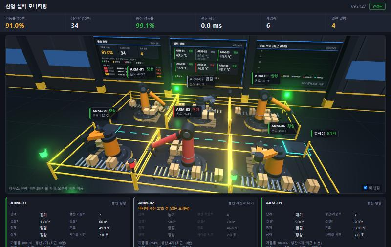
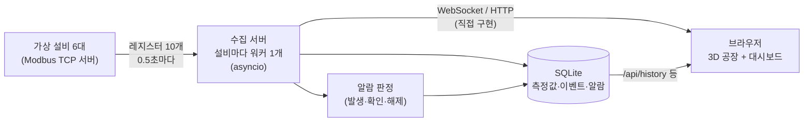
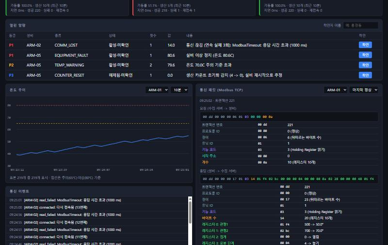

# 산업 설비 디지털 트윈 모니터링

가상 로봇 팔 6대의 상태를 **직접 구현한 Modbus TCP 수집기**로 읽어 저장하고, 알람을 판정하고, 브라우저의 **3D 공장 화면**에 실시간으로 보여 주는 설비 모니터링 시스템입니다.



위 화면은 로봇 5번이 과열로 정지(빨강, 경광등 깜빡임)하고 2번이 통신이 끊긴(회색) 순간입니다. 3D 속 로봇과 벽의 모니터, 아래 설비 카드는 모두 같은 수집값으로 움직입니다.

## 무엇을 하나



- **수집**: 라이브러리 없이 소켓으로 Modbus TCP를 구현했습니다 (요청 12바이트, 응답 29바이트). 설비마다 워커, 연결, 상태가 따로라서 한 설비가 끊겨도 다른 설비는 영향을 받지 않습니다.
- **알람**: 설비 이상, 온도 경고, 통신 끊김, 카운터 초기화 4종. 알람 확인(ACK)과 해제는 서로 독립이라, 값이 정상으로 돌아와도 사람이 확인하기 전에는 닫히지 않습니다.
- **화면**: 로봇 6대(관절 팔, 스카라 팔 두 가지)가 서버가 읽은 관절 각도대로 움직이고, 상자를 집어 팔레트에 쌓고, 이동 로봇(AGV)이 가득 찬 팔레트를 출하장으로 나릅니다. 벽 모니터에는 가동률, 설비 상태, 온도 추이, 최근 알람이 나옵니다.
- **패킷 뷰어**: 설비와 실제로 주고받은 바이트를 헤더, 기능 코드, 주소, 레지스터 값으로 색을 나눠 보여 줍니다. 실패한 패킷도 따로 남습니다.



## 기술 선택

| 영역 | 선택 | 이유 |
|---|---|---|
| 수집 서버 | Python 3.11+ **표준 라이브러리만** (asyncio, socket, sqlite3) | 내려받을 것이 없고, 통신과 바이트 처리를 직접 다룬 것을 보여 주려고 |
| Modbus TCP, WebSocket, HTTP | **직접 구현** (기능 코드 0x03 읽기) | 규격(RFC 6455, MBAP 헤더)을 이해하고 있음을 보여 주려고. 대신 지원 범위는 좁음 |
| 저장 | SQLite (WAL) | 이 규모(설비 100대까지 확인)에 충분하고 설치가 필요 없음 |
| 화면 | 브라우저 ES 모듈 + Three.js 0.170.0 (`web/vendor/`에 보관, 해시 검증) | 인터넷 없이 동작, 3D 모델 파일 없이 기본 도형만 조립 |
| 시험 | `unittest`(Python) + `node --test`(화면 계산) | 실제 소켓과 실제 서버를 띄우는 시험 위주 |

## 실행 방법

Python 3.11 이상이 필요합니다 (3.12에서 개발·시험). 따로 설치할 패키지는 없습니다.

**가장 쉬운 방법 (시연용)**: 로봇 6대와 수집 서버를 한 번에 켜고, 같은 창에서 명령으로 장애를 일으킵니다.

```bash
python tools/demo.py
```

브라우저에서 http://127.0.0.1:8000/ 을 엽니다. `k 4`(4번 전원 끄기), `f 5`(5번 과열), `d 2`(2번 응답 지연), `r 4`(다시 켜기), `q`(종료).
5021~5026이나 8000 포트를 다른 프로그램이 쓰고 있으면 `python tools/demo.py --port-offset 1000 --web-port 8100`으로 포트를 옮길 수 있습니다.

**따로 켜는 방법** (터미널 2개)

```bash
python simulator/run_all.py        # 로봇 6대 (포트 5021~5026). 과열을 빨리 보려면 --heat-rate 1.5
python -m collector                # 수집 서버 + 웹 화면 (http://127.0.0.1:8000/)
```

저장된 값은 `python -m collector.tools samples ARM-01 --limit 5`처럼 터미널에서도 볼 수 있습니다. 기본 보관 기간은 7일이고(`--retention-days`), 알람은 지우지 않습니다.

## 시험과 측정

```bash
python -m unittest discover -s tests -v       # Python 시험 308개 (Node가 있으면 화면 계산 시험 76개도 같이 실행)
node --test "tests/js/*.test.mjs"             # 화면 계산 시험만 (Three.js 없이 실행)
python tools/comm_scenarios.py                # 통신 장애 시나리오 실측 (약 3분)
python tools/loadtest.py --devices 30 --duration 60 --web   # 30대 동시 수집 부하 시험
```

시험이 정말 틀린 코드를 잡는지는 코드를 일부러 망가뜨려서(변이 시험) 확인했습니다. 중간에 약한 시험을 여러 번 발견해 보강했습니다.

### 실측 결과 (이 PC, 같은 PC 안의 루프백 통신)

| 항목 | 결과 |
|---|---|
| 한 설비에 장애를 줘도 다른 설비는? | 영향 없음. 지연, 시간 초과, 연결 끊김, 깨진 응답, 전원 꺼짐 모두 정상 설비는 초당 2.00개 그대로 |
| 설비 전원이 꺼지면 | 0.2초 만에 인지, 약 5초 뒤 통신 끊김 알람(P1). 다시 켜지면 최악 약 4초 안에 복구 |
| **설비 30대 동시 수집** | 수집기 CPU 평균 2.8%(한 코어 기준), 메모리 28MB, 수집 간격 최대 0.55초, **누락 0건** |
| 설비 100대 동시 수집 | CPU 4.6%, 메모리 34MB, 간격 최대 0.54초, 누락 0건 |

측정으로 약점 4가지(응답이 느리면 수집이 줄어듦, 복구 지연, 웹 메시지 크기, 보관 정책 없음)를 찾아 고친 뒤 다시 쟀습니다.
고치기 전과 후의 표, 방법, 한계는 [docs/COMM_TEST.md](docs/COMM_TEST.md)에 있습니다.

## 정직하게 밝혀 둘 점

- **개발 방식**: 설계와 구현은 AI 코딩 도구(Claude Code)의 도움을 받아 진행했습니다. 코드를 직접 읽고 설명할 수 있도록 코드 설명서와 질문·답을 함께 정리했습니다 ([docs/CODE_GUIDE.md](docs/CODE_GUIDE.md)).
- **실제 설비가 아니라 시뮬레이터입니다.** 로봇의 동작과 온도는 정해진 규칙으로 만든 값입니다.
- **AGV와 벽 모니터는 화면 연출입니다.** 서버가 읽는 장치는 로봇 팔 6대뿐입니다. 다만 AGV를 부르는 시점(팔레트가 찼을 때)은 실제 생산 카운트에서 오고, 벽 모니터의 숫자도 실제 수집값입니다.
- **로봇의 모양(관절 팔, 스카라 팔)은 서버 값이 아닙니다.** 설비 이름 끝 번호의 홀짝으로 화면이 정합니다.
- **시험은 같은 PC의 루프백 통신**에서 접속자 1명, 20~60초로 했습니다. 실제 네트워크 손실과 장시간 안정성은 확인하지 못했고, 7일 보관 정책도 단위 시험으로만 확인했습니다.
- **보안은 내 PC 안에서 쓰는 수준입니다.** 기본으로 127.0.0.1에만 열리고, Host와 Origin 검사, 입력 길이와 속도 제한은 있지만 로그인과 암호화(TLS)는 없습니다. 알람 확인자 이름도 인증 없이 입력받는 이름입니다.
- Modbus는 **읽기(0x03)만** 구현했습니다. 설비에 값을 쓰는 제어 명령은 만들지 않았습니다.

## 폴더 구조

```
collector/    수집 서버: modbus.py(직접 구현한 클라이언트), models.py(레지스터 해석), device.py(설비별 워커), alarms.py, store.py,
              webfeed.py(WebSocket·HTTP), packets.py, stats.py, api.py, commands.py, retention.py, tools.py
simulator/    가상 설비: robot_sim.py(동작 모델), modbus_sim.py(Modbus 서버+장애 주입), run_all.py(6대 실행)
web/          브라우저 화면: index.html, app.js, scene.js(3D), factory_env.js(공장·벽 모니터), bloom.js,
              robot_math.js·agv_logic.js·factory_logic.js(계산만 분리), vendor/(Three.js 원본)
tests/        자동 시험 (Python 308개, 화면 계산 Node 76개)
tools/        시연 실행기(demo.py), 통신 시나리오(comm_scenarios.py), 부하 시험(loadtest.py), 측정 도우미(measure.py)
docs/         PLAN.md(계획·설계), CODE_GUIDE.md(코드 설명·면접 질문), COMM_TEST.md(측정 결과), DEMO_SCRIPT.md(영상 대본)
archive/      처음 시도한 C# 수집기 (이 PC의 실행 차단으로 Python으로 전환, 보관만)
```

## 문서

- [docs/PLAN.md](docs/PLAN.md): 요구, 설계 결정, 레지스터 맵, 일정과 진행 상황
- [docs/CODE_GUIDE.md](docs/CODE_GUIDE.md): 데이터가 흐르는 길, 파일별 설명, Three.js 쉬운 설명, 설계 결정과 이유, 질문과 답, 직접 해 보는 실습
- [docs/COMM_TEST.md](docs/COMM_TEST.md): 통신 장애와 부하 시험 결과, 개선 전후 비교
- [web/vendor/VENDOR.md](web/vendor/VENDOR.md): 외부에서 가져온 파일의 출처, 해시, 라이선스 (Three.js, MIT)

## 사용 범위

이 저장소는 취업 포트폴리오 목적으로 공개합니다. 코드를 읽고, 내려받아 실행해 보는 평가는 환영합니다.
복사, 수정, 재배포는 허락 없이 할 수 없습니다 (별도의 라이선스를 부여하지 않았습니다).
`web/vendor/`의 Three.js 파일은 원래의 MIT 라이선스를 따르며 [web/vendor/THREE-LICENSE.txt](web/vendor/THREE-LICENSE.txt)에 있습니다.
